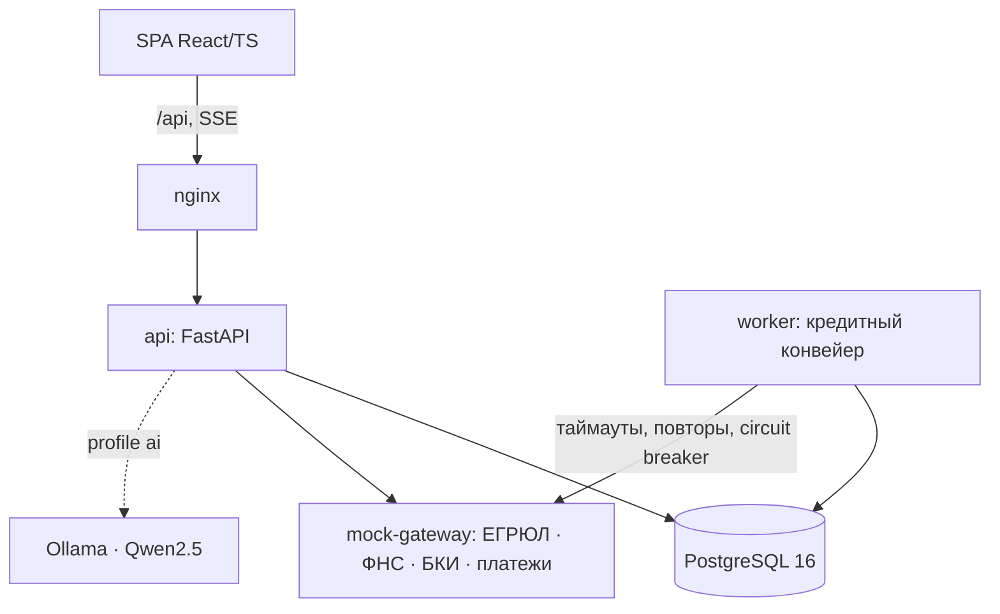

# Умный кредитный кабинет предпринимателя

Прототип **цифрового кредитного конвейера для малого и микробизнеса** (кейс «Альфа Будущее» × Альфа-Банк, 2026).
Предприниматель проходит весь путь: от потребности в деньгах до зачисления кредита. Банк в том же продукте обрабатывает заявку: автоматические проверки, скоринг, решение, ручное рассмотрение и эскалация.

**Что умеет**
- **Кабинет клиента.** Подбор продукта от задачи с предварительной оценкой без запроса в БКИ. Пошаговая анкета с автосохранением и автозаполнением из профиля и ЕГРЮЛ. Распознавание отчётности. Статус заявки обновляется в реальном времени (SSE). Запросы банка приходят задачами внутри кабинета. Есть встречное предложение, подписание кодом, выдача и график платежей, чат с банком и помощник.
- **Кредитный конвейер.** Проверка полноты → обогащение (ЕГРЮЛ/ЕГРИП, ФНС «Прозрачный бизнес», БКИ, обороты в банке) → балльный скоринг A–E → кредитная политика с 4 исходами: одобрение, встречное предложение, специалист, отказ. Правила версионируются.
- **Рабочее место банка.** Очередь с фильтрами. Карточка с разбором скоринга и сырыми ответами источников. Решения: одобрить, отказать, встречное предложение, запросить данные, эскалировать. Полномочия по ролям, аудит. Аналитика воронки и симулятор сбоев интеграций.
- **Персональная новостная лента.** Зависит от отрасли, размера и формы бизнеса и **стадии заявки**. У каждой карточки есть пояснение «почему вы это видите».

> Все внешние системы смоделированы (`mock-gateway`), все данные синтетические. Доступ к системам банка не нужен.

---

## Быстрый старт

Требования: **Docker Desktop / Docker Engine 24+ с Compose v2**, 4 ГБ RAM, свободные порты 8080 и 8000.

```bash
git clone https://github.com/EnsixD/alfa-smart-credit-cabinet.git
cd alfa-smart-credit-cabinet
docker compose up --build
```

Откройте **http://localhost:8080** — откроется публичная главная страница. «Войти» → «Демо-аккаунты» → выберите сценарий (пароль у всех `demo123`). Кабинет клиента — `/cabinet`, рабочее место банка — `/bank`.

| Адрес | Что там |
|---|---|
| http://localhost:8080 | Веб-интерфейс (клиент и банк) |
| http://localhost:8000/docs | Swagger UI |
| http://localhost:8000/metrics | Метрики Prometheus |

Опционально, LLM-ассистент на open-weights модели (Qwen2.5 1.5B через Ollama, около 1 ГБ):
```bash
LLM_ENABLED=true docker compose --profile ai up --build
```

### Запуск без Docker (для разработки)
```bash
python -m venv .venv && .venv/Scripts/pip install -r backend/requirements.lock -r backend/requirements-dev.txt   # Linux/macOS: .venv/bin/pip
cd mock-gateway && ../.venv/Scripts/uvicorn gateway:app --port 8081 &
cd backend && ../.venv/Scripts/uvicorn app.main:app --port 8000 &   # SQLite по умолчанию
cd backend && ../.venv/Scripts/python -m app.worker &
cd frontend && npm ci && npm run dev                                  # http://localhost:5173
```
Тесты: `cd backend && ../.venv/Scripts/python -m pytest`. Тесты сами поднимают mock-gateway и проходят все сценарии.

---

## Демо-учётки и сценарий проверки (5 минут)

| Логин | Кто | Что показывает |
|---|---|---|
| `client_good` | ИП, кофейня | Автоодобрение → подписание → выдача |
| `client_counter` | ООО, опт | Встречное предложение (дольше срок) |
| `client_info` / `accountant_info` | ООО «ЭкоПласт», директор / бухгалтер | Запрос документов, роль без права подписи |
| `client_manual` | ООО «СтройМаш» | Инвест-кредит 40 млн → специалист → эскалация |
| `client_reject` | ИП, автосервис | Отказ из-за просрочки, с рекомендациями |
| `client_liquidated` | ООО в ликвидации | Стоп-фактор ЕГРЮЛ |
| `client_young` | ИП 2 мес. | Другая лента и доступные продукты |
| `underwriter` / `approver` / `admin` | Банк | Очередь, решения, полномочия, симулятор сбоев |

**Основной сценарий:**
1. На главной странице нажмите «Войти» → «Демо-аккаунты» → `client_good`. В кабинете — заявки и лента новостей под общепит с пометкой «Почему вы это видите».
2. «Рассчитать» → шаг «Основные данные»: цель «Закупить товар», 1 000 000 ₽, 12 мес. → «Далее».
3. Шаг «Финансы»: 5 продуктов с платежом и шансом одобрения → «Экспресс-кредит» → «Далее» → «Документы»: согласия → «Отправить заявку» → «Заявка отправлена!» → «Перейти в кабинет».
4. Статус меняется вживую: проверка данных → проверка компании → оценка → **Одобрено**. Видны все проверки и что повлияло на оценку.
5. «Принять» → введите показанный код → «Подписать». Статус «Деньги зачислены», баланс вырос, на главной появились кредит с графиком и **другая лента** (стадия «выдано»).
6. Войдите как `client_manual`, подайте «Инвестиционный кредит» на 40 000 000 ₽ / 60 мес. с залогом и документами из [`demo-docs/`](demo-docs). Заявка уйдёт к специалисту.
7. Войдите как `underwriter` → «Требуют решения» → карточка со скорингом и проверками. «Одобрить» отклоняется (выше полномочий), поэтому «Эскалировать». Затем `approver` → «Одобрить».
8. `admin` → «Аналитика и интеграции» → БКИ «Недоступен» → новая заявка уходит к специалисту, а не падает.

Полный набор из 12 сценариев: [docs/test-scenarios.md](docs/test-scenarios.md).

---

## Архитектура



| Компонент | Технологии | Назначение |
|---|---|---|
| `web` | React 18, TypeScript, Vite, GSAP, nginx | Кабинет клиента и рабочее место банка, reverse proxy |
| `api` | Python 3.12, FastAPI, SQLAlchemy 2, PyJWT | REST API, RBAC, машина состояний, SSE, OpenAPI |
| `worker` | тот же образ, `python -m app.worker` | Шаги конвейера и выдача. Очередь `jobs` в Postgres (`FOR UPDATE SKIP LOCKED`), горизонтально масштабируется |
| `db` | PostgreSQL 16 | Заявки, журнал событий (аудит), очередь задач |
| `mock-gateway` | FastAPI | Симулятор внешних систем и их сбоев |
| `ollama` | Ollama + Qwen2.5 (opt.) | Генерация ответов помощника |

Подробно: [docs/architecture.md](docs/architecture.md).

## Документация
| Документ | Содержание |
|---|---|
| [docs/architecture.md](docs/architecture.md) | Архитектурная схема (C4), ключевые решения, безопасность и надёжность |
| [docs/state-diagram.md](docs/state-diagram.md) | Диаграмма состояний заявки и таблица статусов |
| [docs/data-model.md](docs/data-model.md) | ER-модель данных и JSON-поля |
| [docs/api.md](docs/api.md) | Описание API |
| [docs/openapi.json](docs/openapi.json) | OpenAPI 3.1 (также живой Swagger на `/docs`) |
| [docs/postman_collection.json](docs/postman_collection.json) | Коллекция запросов: сквозной сценарий клиента и банка |
| [docs/scoring.md](docs/scoring.md) | Скоринг, кредитная политика, объяснимость |
| [docs/test-scenarios.md](docs/test-scenarios.md) | Тестовые сценарии |
| [docs/research.md](docs/research.md) | Персоны, JTBD, боли → решения, MoSCoW |
| [docs/assumptions.md](docs/assumptions.md) | Допущения и упрощения MVP |
| [THIRD_PARTY_NOTICES](THIRD_PARTY_NOTICES) | Сторонние компоненты, модели, смоделированные интеграции |

## Конфигурация (переменные окружения)
Все переменные имеют значения по умолчанию, шаблон лежит в [`.env.example`](.env.example).

| Переменная | По умолчанию | Описание |
|---|---|---|
| `DATABASE_URL` | Postgres из compose (`sqlite:///./credit.db` вне Docker) | Строка подключения SQLAlchemy |
| `JWT_SECRET` | `change-me-in-production` | Секрет подписи токенов |
| `JWT_TTL_MINUTES` | `720` | Время жизни сессии |
| `MOCK_GATEWAY_URL` | `http://mock-gateway:8081` | Адрес внешних систем |
| `INTEGRATION_TIMEOUT_S` / `INTEGRATION_RETRIES` | `3.0` / `2` | Таймаут и повторы интеграций |
| `PIPELINE_STEP_DELAY_S` | `1.5` | Пауза между шагами конвейера, чтобы движение статусов было видно вживую (0 — без паузы) |
| `WORKER_REPLICAS` | `1` | Число воркеров конвейера |
| `INLINE_PIPELINE` | `false` | Выполнять конвейер внутри API без воркера (тесты) |
| `SEED_ON_START` | `true` | Залить синтетические данные при первом старте |
| `LLM_ENABLED` / `LLM_MODEL` / `LLM_URL` | `false` / `qwen2.5:1.5b` / `http://ollama:11434` | LLM-ассистент |
| `MAX_UPLOAD_MB` | `10` | Лимит размера документа |

Версии зафиксированы: `backend/requirements.lock`, `frontend/package-lock.json`, `.python-version`, `frontend/.nvmrc`, теги Docker-образов без `latest`.

## Структура репозитория
```
backend/        FastAPI: app/ (models, state_machine, credit, pipeline, worker, routers, rules/ruleset.yaml, seed), tests/
mock-gateway/   симулятор ЕГРЮЛ/ФНС/БКИ/платежей + fixtures.json
frontend/       React SPA + nginx
demo-docs/      синтетические документы для загрузки
docs/           архитектура, API, OpenAPI, коллекция, диаграммы, сценарии
```

## Ограничения и развитие
Реальные интеграции через шину банка, УКЭП, ML-скоринг на исторических данных с мониторингом стабильности, Alembic-миграции, S3 для документов, Keycloak, сопровождение кредита после выдачи. См. [docs/assumptions.md](docs/assumptions.md).
