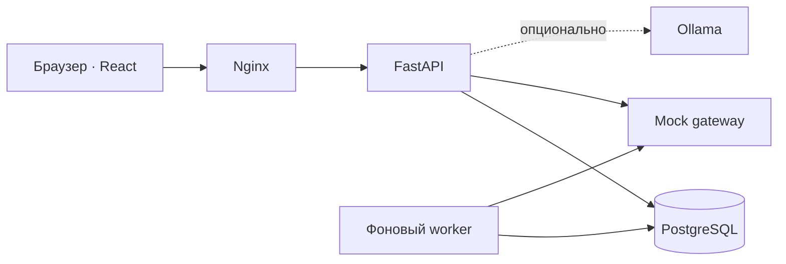

# Вектор · кредитный кабинет для бизнеса

**От первого плана до денег на счёте — в одном продукте.**

Прототип цифрового кредитного конвейера для малого и микробизнеса. Предприниматель выбирает финансирование, подаёт заявку и следит за решением. Сотрудник банка получает проверки, объяснимый скоринг и инструменты для рассмотрения в том же приложении.

Кейс **«Альфа Будущее» × Альфа-Банк · 2026**.

[Быстрый старт](#быстрый-старт) · [Демосценарии](#попробуйте-разные-сценарии) · [Архитектура](#как-это-устроено) · [Документация](#документация)

> Хакатонный прототип, а не официальный сервис банка. Компании, документы и финансовые данные синтетические. Внешние интеграции работают через отдельный mock-gateway.

## Один путь. Две стороны.

| Для предпринимателя | Для команды банка |
| --- | --- |
| Подбор кредита под задачу и предварительный расчёт | Очередь заявок с фильтрами и распределением по ролям |
| Анкета с автосохранением и данными компании | Проверки ЕГРЮЛ/ЕГРИП, ФНС, БКИ и банковских оборотов |
| Статусы в реальном времени, задачи и чат | Объяснимый скоринг A–E и версионируемые правила |
| Встречное предложение и подписание кодом | Одобрение, отказ, запрос данных и эскалация |
| Выдача, карточка договора, диаграмма и таблица платежей | Аудит решений, аналитика воронки и симулятор сбоев |

### Интерфейс, который помогает двигаться дальше

Красный акцент, графитовый фон и крупная типографика объединяют публичный сайт и кабинет. Анимированная сетка работает автоматически; кнопки сохраняют положение при наведении. Переходы между разделами, фильтрами и видами графика плавные, а настройка сокращения движения учитывается на уровне приложения.

- **Финансирование:** каталог продуктов, условия и предварительный аннуитетный расчёт.
- **Заявки:** понятные этапы, история, проверки и действия, доступные на текущей стадии.
- **Кредиты:** отдельная страница договора, состав платежа по месяцам и экспорт графика в CSV.
- **Вход:** демосценарии для бизнеса и банка без ручного ввода реквизитов.

## Быстрый старт

Нужны **Docker Desktop / Docker Engine 24+**, Compose v2, около 4 ГБ оперативной памяти и свободные порты 8080 и 8000.

```bash
git clone https://github.com/EnsixD/alfa-smart-credit-cabinet.git
cd alfa-smart-credit-cabinet
docker compose up --build
```

Или одним файлом: **`start.bat`** на Windows (двойной клик), **`./start.sh`** на macOS и Linux. Скрипт проверит Docker, поднимет все сервисы, дождётся готовности и откроет браузер. Остановка — `stop.bat`.

Первый запуск собирает образы, поднимает базу и создаёт демоданные.

| Адрес | Что откроется |
| --- | --- |
| [localhost:8080](http://localhost:8080) | Сайт, вход и кабинеты |
| [localhost:8000/docs](http://localhost:8000/docs) | Интерактивная документация API |
| [localhost:8000/metrics](http://localhost:8000/metrics) | Метрики приложения |

Для настройки скопируйте `.env.example` в `.env`. Все переменные необязательны — у каждой есть значение по умолчанию. Перед размещением за пределами локальной среды замените `JWT_SECRET` и `POSTGRES_PASSWORD`.

| Переменная | По умолчанию | Назначение |
| --- | --- | --- |
| `POSTGRES_PASSWORD` | `credit` | Пароль базы PostgreSQL |
| `JWT_SECRET` | `change-me-in-production` | Ключ подписи токенов входа |
| `PIPELINE_STEP_DELAY_S` | `1.5` | Пауза между шагами конвейера, чтобы статусы менялись заметно |
| `WORKER_REPLICAS` | `1` | Число экземпляров фонового worker |
| `LLM_ENABLED` | `false` | Подключить языковую модель к помощнику |
| `LLM_MODEL` | `qwen2.5:1.5b` | Модель Ollama (только с открытыми весами) |

```bash
docker compose down
```

Команда останавливает сервисы; данные остаются в Docker volume.

**Режим разработки.** Фронтенд запускается с hot reload: правки в `frontend/src` сразу видны на [localhost:8080](http://localhost:8080), пересобирать образ не нужно.

```bash
docker compose -f docker-compose.yml -f docker-compose.dev.yml up --build
```

**Очистка тестовых данных.** Удаляет заявки, кредиты, документы и уведомления. Аккаунты, компании, продукты и новости остаются.

```bash
docker compose exec api python -m app.reset_data
```

## Попробуйте разные сценарии

На странице входа нажмите **«Открыть демоверсию»** и выберите аккаунт. Вход выполнится сразу. Для ручного входа пароль всех демоаккаунтов — `demo123`.

| Аккаунт | Сценарий |
| --- | --- |
| `client_good` | Кофейня: автоматическое одобрение, подписание и выдача |
| `client_counter` | Оптовая компания: встречное предложение банка |
| `client_info` | Производство: банк запрашивает дополнительные документы |
| `accountant_info` | Бухгалтер той же компании без права подписи |
| `client_manual` | Крупная заявка: специалист и эскалация руководителю |
| `client_reject` | Автосервис: отказ с рекомендациями |
| `client_liquidated` | Компания в процессе ликвидации |
| `client_young` | Молодой бизнес с короткой историей |
| `underwriter` | Проверка и рассмотрение заявок |
| `approver` | Решения по эскалированным заявкам |
| `admin` | Правила, аналитика и инструменты демонстрации |

### Демонстрация за пять минут

1. Войдите за кофейню и подберите финансирование.
2. Заполните заявку и наблюдайте автоматические проверки.
3. Подпишите договор кодом из демонстрационного сценария.
4. Откройте выданный кредит: сравните диаграмму и таблицу платежей.
5. Сравните ленту новостей на главной кабинета у `client_good` и `client_young`: подборка зависит от отрасли, размера бизнеса и статуса заявки, у каждой карточки есть пояснение «Почему вы это видите».
6. Переключитесь на сценарий ручного рассмотрения и продолжите за сотрудника банка.

Подробные маршруты, включая отказы и сбои интеграций: [сценарии демонстрации](docs/test-scenarios.md).

## Как это устроено



**Конвейер:** полнота анкеты → обогащение данных → скоринг → кредитная политика → решение → подписание → выдача.

Фоновый worker обрабатывает заявки независимо от браузера. Статусы доставляются через SSE. Политика поддерживает четыре исхода: одобрение, встречное предложение, ручное рассмотрение и отказ. Решения и действия сохраняются в аудите.

| Слой | Технологии |
| --- | --- |
| Интерфейс | React 18, TypeScript, Vite, Motion, GSAP, React Bits |
| API и бизнес-логика | Python 3.12, FastAPI, SQLAlchemy 2, PyJWT |
| Данные и обработка | PostgreSQL 16, worker с `SKIP LOCKED` |
| Интеграции | Отдельный FastAPI mock-gateway |
| Развёртывание | Docker Compose, Nginx |
| Необязательный помощник | Ollama, Qwen2.5 1.5B |

### Локальный помощник — по желанию

Основные сценарии работают без языковой модели. Для подключения Ollama включите `LLM_ENABLED=true` в `.env`, затем запустите:

```bash
docker compose --profile ai up --build
```

Первый запуск дополнительно скачает модель размером около 1 ГБ. Ей потребуются дополнительная память и место на диске.

### Разработка интерфейса

При работающем API на порту 8000:

```bash
cd frontend
npm ci
npm run dev
```

Vite проксирует запросы к API; адрес разработки — [localhost:5173](http://localhost:5173). Производственная сборка: `npm run build`.

## Документация

| Раздел | Содержание |
| --- | --- |
| [Архитектура](docs/architecture.md) | Сервисы, обработка и границы системы |
| [Жизненный цикл](docs/state-diagram.md) | Состояния заявки и допустимые переходы |
| [Модель данных](docs/data-model.md) | Сущности и связи |
| [API](docs/api.md) | Контракты и примеры запросов |
| [OpenAPI](docs/openapi.json) · [Postman](docs/postman_collection.json) | Машиночитаемые спецификации |
| [Скоринг](docs/scoring.md) | Признаки, баллы и кредитная политика |
| [Сценарии](docs/test-scenarios.md) | Демонстрация и проверка потоков |
| [Исследование](docs/research.md) | Контекст задачи и продуктовые решения |
| [Допущения](docs/assumptions.md) | Упрощения прототипа |
| [Дизайн](docs/DESIGN_SYSTEM.md) | Компоненты и визуальная система |
| [Сторонние материалы](THIRD_PARTY_NOTICES) | Источники и лицензии |

## Границы прототипа

Интеграции с государственными источниками и БКИ смоделированы. Подписание кодом демонстрирует пользовательский путь и не заменяет УКЭП. Скоринг основан на прозрачных правилах, а не на промышленной ML-модели. Для промышленного запуска потребуются реальные шлюзы, инфраструктура хранения документов, миграции, усиленная аутентификация и эксплуатационные процедуры.

**Вектор** — вымышленный бренд хакатонного продукта. Названия реальных организаций используются для описания кейса и интеграций.
