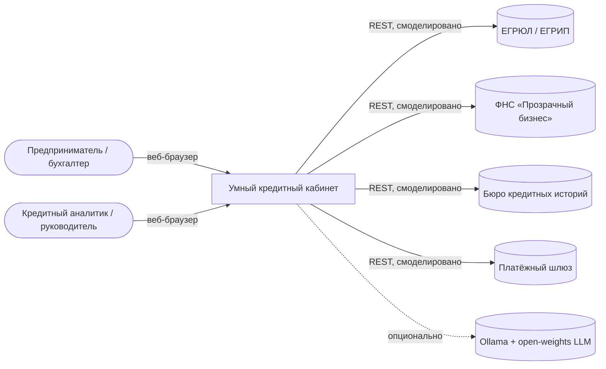
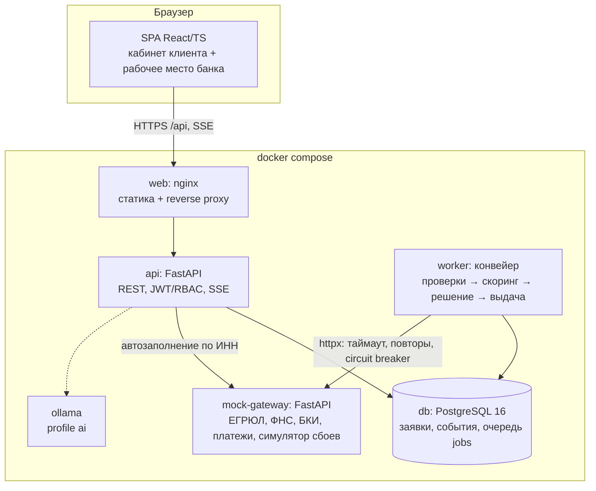

# Архитектура

## Контекст (C4, уровень 1)

## Контейнеры (C4, уровень 2)

## Ключевые решения

| Решение | Почему |
|---|---|
| **API и воркер — отдельные процессы**, общаются через таблицу `jobs` в Postgres (`SELECT … FOR UPDATE SKIP LOCKED`) | Конвейер не блокирует запросы клиента; воркеры масштабируются независимо (`WORKER_REPLICAS`); не нужен отдельный брокер — меньше движущихся частей для MVP. Транзакционная запись заявки и задачи в одной транзакции — паттерн outbox. |
| **Каждый шаг конвейера — отдельная транзакция + событие в `application_events`** | Клиент видит движение статуса в реальном времени (SSE), а журнал событий одновременно служит аудитом. |
| **Машина состояний в одном модуле** (`state_machine.py`) | Невозможно перевести заявку в недопустимый статус ни из API, ни из воркера; диаграмма = код. |
| **Скоринг и решение — чистые функции**, правила в версионируемом YAML | Тестируемость, воспроизводимость (`ruleset_version` в каждом решении), объяснимость факторов. Правила меняются без изменения кода. |
| **Внешние системы за клиентом с таймаутом, повторами и circuit breaker** | Недоступность БКИ/ФНС не роняет конвейер — заявка уходит на ручную проверку. Демонстрируется в «Аналитика → Симулятор интеграций». |
| **SSE вместо WebSocket** | Однонаправленный поток статусов, работает через обычный HTTP/nginx, автоматическое переподключение браузером. |
| **Идемпотентность отправки** (`Idempotency-Key`) и **оптимистичная блокировка** (`version`) | Двойной клик/повтор запроса не создаёт дублей; правки в двух вкладках не затирают друг друга. |
| **LLM опционален** (profile `ai`, open-weights Qwen2.5) | Основной сценарий не зависит от модели; при недоступности — детерминированный режим на правилах. |

## Безопасность и надёжность
- JWT (HS256) + RBAC: `CLIENT` видит только заявки своей компании; `UNDERWRITER`, `APPROVER`, `ADMIN` — банковские роли с разными полномочиями (лимит аналитика 30 млн ₽, выше — эскалация).
- Разграничение внутри компании: сотрудник без права подписи (`can_sign=false`, например бухгалтер) может оформить заявку, но не подписать договор.
- Пароли — PBKDF2-SHA256 (200 000 итераций, соль). Секреты — только через переменные окружения.
- Логи — структурированные JSON, без тел запросов и персональных данных.
- Контейнеры запускаются от непривилегированного пользователя, у всех сервисов healthcheck и `restart: unless-stopped`.
- Метрики Prometheus: `GET /metrics` (запросы, ошибки, заявки по статусам, задачи конвейера).
- Повторы задач воркера с backoff (до 3 попыток), ошибка шага не останавливает воркер.

## Что упрощено (см. также [assumptions.md](assumptions.md))
Схема БД создаётся через `create_all` (в продуктиве — Alembic-миграции), файлы документов хранятся в БД (в продуктиве — S3/MinIO), авторизация собственная (в продуктиве — Keycloak/корпоративный IdP).
