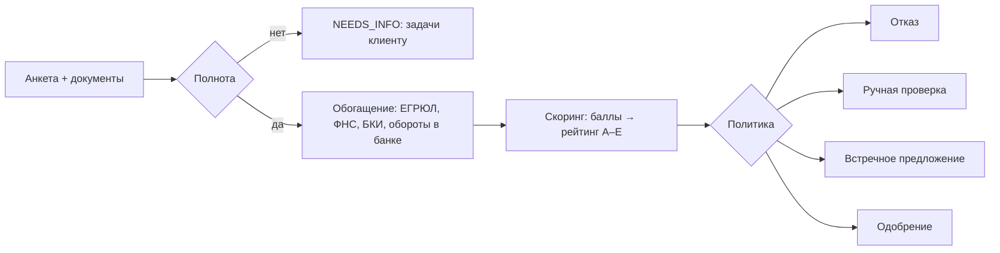

# Скоринг и кредитное решение

Скоринг и решение намеренно разделены (как и требует кейс): **скоринг** отвечает на вопрос «насколько рискован заёмщик», **кредитная политика** — «что ему предложить с учётом продукта, суммы, срока, проверок и правил банка». Поэтому одинаковый рейтинг даёт разные условия для разных продуктов (тест `test_same_risk_different_products_different_terms`).

Код: [`backend/app/credit.py`](../backend/app/credit.py). Правила: [`backend/app/rules/ruleset.yaml`](../backend/app/rules/ruleset.yaml) (версия сохраняется в каждом решении).

## 1. Конвейер

## 2. Балльная модель (scorecard)
База — 500 баллов. Каждый фактор добавляет/вычитает баллы по корзинам из YAML:

| Фактор | Источник | Пример влияния |
|---|---|---|
| Возраст бизнеса | ЕГРЮЛ/ЕГРИП | < 1 года −40, > 3 лет +60 |
| Рентабельность (выручка − расходы) / выручка | анкета | < 0 −80, > 20% +60 |
| Динамика выручки к прошлому году | анкета | падение > 20% −50, рост +30 |
| **DSCR** = чистый поток / (текущие платежи + новый платёж) | анкета + БКИ | < 1,0 −120, > 2,0 +70 |
| Сумма / годовая выручка | заявка | > 50% −50 |
| Просрочки за 12 мес. | БКИ | 0: +60, систематические −120 |
| Длина кредитной истории | БКИ | нет −10, > 2 лет +30 |
| Обороты по счёту в банке | внутренние данные | +30 |
| Риск отрасли (ОКВЭД) | справочник | высокий −30, низкий +20 |

Рейтинг: A ≥ 720, B ≥ 640, C ≥ 560, D ≥ 480, E — ниже. Надбавка к базовой ставке продукта: A +0, B +1,5, C +3, D +5 п.п.

## 3. Кредитная политика (порядок применения)
1. **Стоп-факторы → отказ**: компания ликвидируется/не найдена; текущая просрочка > 30 дней; возраст бизнеса меньше минимального для продукта (с подсказкой доступных продуктов).
2. **Высокий риск (D, E) → отказ** с тремя главными негативными факторами и рекомендациями.
3. **Платёжеспособность**: максимальная сумма = min(сумма при DSCR ≥ 1,25; 50% годовой выручки для беззалоговых; лимит продукта). Если запрос больше:
   1. увеличиваем срок (шаг 6 мес.) — **встречное предложение с тем же размером кредита**;
   2. иначе снижаем сумму до допустимой;
   3. иначе предлагаем другой продукт;
   4. иначе отказ.
4. **Ручная проверка**, если: БКИ/ФНС недоступны, есть флаги ФНС (массовый адрес, дисквалификация), налоговый долг > 100 тыс., залоговый продукт, рейтинг C, сумма выше лимита автоматического решения продукта, расхождение выручки с оборотами > 30%.
5. Иначе — **автоматическое одобрение**.

Полномочия: аналитик одобряет до 30 млн ₽, выше — эскалация руководителю (`APPROVER`).

## 4. Объяснимость
- Банку: все факторы с баллами, метрики (DSCR, рентабельность, платёж), версия правил, сырые ответы источников.
- Клиенту: без баллов — «что помогло» и «что снизило оценку», причины решения и что сделать дальше.

## 5. Предварительная оценка (до подачи)
`POST /api/catalog/recommend` считает тот же скоринг по данным счёта в банке **без запроса в БКИ** и показывает шанс одобрения по каждому продукту — клиент выбирает продукт осознанно и не тратит попытку впустую.

## 6. Развитие
Заменить scorecard на логистическую регрессию/градиентный бустинг, обученные на исторических данных, с мониторингом Gini/PSI; A/B-тестирование версий ruleset; калибровка PD.
