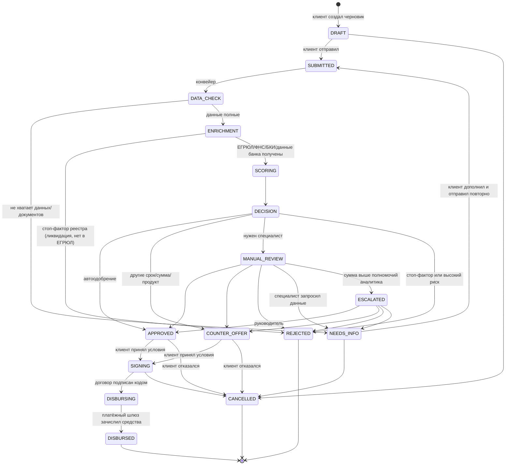

# Диаграмма состояний заявки

Источник правды — [`backend/app/state_machine.py`](../backend/app/state_machine.py). Любой переход вне этой схемы отклоняется (HTTP 409).

## Статусы

| Статус | Кто переводит | Клиент видит | Этап прогресс-бара |
|---|---|---|---|
| DRAFT | клиент | Черновик (автосохранение) | Заявка |
| SUBMITTED | клиент | Отправлена | Проверка данных |
| DATA_CHECK | конвейер | Проверяем полноту данных | Проверка данных |
| NEEDS_INFO | конвейер / специалист | Нужны уточнения + список задач | Проверка данных |
| ENRICHMENT | конвейер | Проверяем компанию (ЕГРЮЛ, ФНС, БКИ) | Анализ |
| SCORING | конвейер | Оцениваем финансы | Анализ |
| DECISION | конвейер | Формируем решение | Анализ |
| MANUAL_REVIEW | конвейер | На рассмотрении у специалиста | Анализ |
| ESCALATED | аналитик | На согласовании | Анализ |
| APPROVED | конвейер / специалист | Одобрено, условия | Решение |
| COUNTER_OFFER | конвейер / специалист | Встречное предложение (сравнение) | Решение |
| REJECTED | конвейер / специалист | Отказ: причины и рекомендации | Решение |
| SIGNING | клиент | Подписание договора | Подписание |
| DISBURSING | клиент (подпись) | Зачисляем деньги | Выдача |
| DISBURSED | конвейер | Деньги зачислены, график платежей | Выдача |
| CANCELLED | клиент | Отменена | — |

Каждый переход записывается в `application_events` (кто, когда, из какого статуса, комментарий) и порождает уведомление клиенту внутри кабинета.
